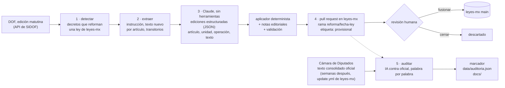

<p align="center">
  <a href="https://pivotek.mx"></a>
</p>

<p align="center">
  
</p>

<p align="center">
  <a href="README.md">English</a> · <b>Español</b> · <a href="https://beg-lag.github.io/reforma-al-dia/">Marcador</a>
</p>

<p align="center">
  <a href="https://github.com/BEG-lag/reforma-al-dia/actions/workflows/ci.yml"></a>
  <a href="LICENSE"></a>
  
  
  
</p>

# reforma-al-dia

**La mañana en que se publica una reforma, la ley ya está actualizada, como pull request.**
Cuando el *Diario Oficial de la Federación* (DOF) publica un decreto que reforma alguna de las
leyes federales de [leyes-mx](https://github.com/BEG-lag/leyes-mx), un agente de IA aplica los
cambios al texto en Markdown de esa ley esa misma mañana y abre un pull request para que una
persona lo revise y lo fusione. Semanas después, cuando la Cámara de Diputados publica su texto
consolidado oficial, el sistema se audita a sí mismo: compara, palabra por palabra, lo que aplicó
la IA con el texto oficial y mantiene un marcador público de precisión.

> [!IMPORTANT]
> **Texto provisional aplicado por IA. Sólo el DOF es fuente oficial. No es asesoría legal.**

## Los números (backtest con reformas reales)

Antes de confiarle el DOF de mañana, todo el proceso se repitió sobre **34 decretos reales**
publicados entre abril de 2019 y octubre de 2026, en **16 leyes** (la Constitución, la Ley de
Amparo, la Ley de Aguas Nacionales, la Ley Federal de Competencia Económica, los códigos civil,
de comercio, fiscal y penal, entre otras). Para cada uno, leyes-mx tiene la ley tal como estaba la
mañana anterior al decreto y la consolidación oficial posterior, con ese único decreto en medio.
El proceso partió de la versión anterior y del texto del DOF, exactamente como lo habría hecho ese
día, y el resultado se comparó con el texto oficial.

| Resultado, por artículo que aplicó la IA | Artículos | Proporción |
|---|---:|---:|
| **Exacto**: idéntico al texto oficial, byte por byte | **582** | **90.7%** |
| **Normalizado**: idéntico al normalizar espacios, puntuación y comillas | 33 | 5.1% |
| **Diferente**: otras palabras; cada uno se publica con su diff por palabra | 27 | 4.2% |
| *Total aplicado* | *642* | |
| No aplicado: el decreto lo cambió y la IA lo mandó a revisión humana en vez de adivinar | 1 | |
| Cambiado por la Cámara fuera del decreto (excluido) | 22 | |

Qué son los 27 artículos diferentes, clasificados con código determinista y luego leídos uno por uno:

- **20** difieren sólo en marcadores de derogación: el decreto imprime «Se deroga.» para un párrafo
  derogado y la IA lo copia; la Cámara a veces quita esas líneas del texto consolidado (y a veces
  las conserva, por ejemplo «XV. Se deroga» en la misma ley).
- **1** difiere sólo porque el texto oficial agrega una anotación de la Cámara (cantidades actualizadas).
- **6** difieren en el texto. Al leerlos: 3 son de la Ley Federal de Competencia Económica, cuya
  versión oficial es de cuatro meses después del decreto y ya incluye un decreto posterior (la
  homologación al Código Nacional de Procedimientos Civiles y Familiares); 1 es un párrafo del
  siguiente artículo del decreto que el archivo fuente pegó al texto oficial; 1 conserva una
  anotación de la SCJN que la Cámara quitó; y **1 es un error real de la IA**: en el artículo 25
  de esa misma ley el modelo contó de otra forma los marcadores «...» y conservó un párrafo que el
  decreto sustituyó.

Otras mediciones: las notas editoriales («Fracción reformada DOF ...») coinciden exactamente en
556 de 642 artículos; el bloque de transitorios del decreto coincide en 27 de 35 casos (8 exactos,
19 normalizados); y en **12 de 35** casos el cuerpo completo de la ley es idéntico al oficial.
Sólo 2025 y 2026 (14 decretos): 497 exactos, 33 normalizados y 22 diferentes de 552 artículos
aplicados (90.0% exactos).

Cada caso se puede revisar artículo por artículo (texto anterior, texto de la IA, texto oficial y
diff) en el [marcador](https://beg-lag.github.io/reforma-al-dia/), y los datos están en
[`data/auditoria.json`](data/auditoria.json) y [`data/casos/`](data/casos/). La regla de selección y
los pares descartados, con su motivo, están en [`data/backtest.json`](data/backtest.json).

Fueron **94 llamadas** a Claude (Opus 5.5 a través del CLI de Claude Code del dueño), unos 40 minutos
de tiempo de modelo en total, 25 segundos por llamada en promedio. Cada respuesta queda en
[`data/cache/claude/`](data/cache/claude/), así que `reforma-al-dia backtest run --offline`
reproduce todos estos números sin llamar al modelo.

## Cómo funciona



1. **Detectar.** Para una fecha se filtra el sumario del DOF (la API pública de SIDOF, la misma que
   documenta [mcp-dof](https://github.com/BEG-lag/mcp-dof)): decretos que *reforman*, *adicionan* o
   *derogan* y nombran una ley del catálogo de leyes-mx, o que tienen un título genérico («diversos
   ordenamientos»). Decide el texto completo: sólo cuentan los decretos del Congreso, y cada
   artículo resolutivo («Artículo Segundo.- Se reforman ... de la Ley X») se asocia a su ley. Un
   decreto puede reformar varias leyes.
2. **Extraer.** El HTML del decreto se vuelve párrafos; la parte de cada ley se divide en la
   instrucción, un bloque de texto nuevo por artículo (con los «...» que representan texto que no
   cambia), encabezados de división y transitorios. La instrucción también se interpreta con código
   determinista como (operación, artículo, unidad) para saber qué artículos deben cambiar.
3. **Aplicar con Claude.** El modelo recibe la instrucción, el texto del decreto de cada artículo y
   el texto vigente de ese artículo en bloques numerados, y devuelve **ediciones estructuradas**:
   para cada unidad (párrafo, fracción, inciso...) la operación (reforma, adición, derogación), los
   bloques que sustituye o después de cuál va, y el texto nuevo exacto. Nunca un archivo reescrito.
   Se ejecuta como `claude -p --output-format json --json-schema ... --tools "" --strict-mcp-config
   --safe-mode --setting-sources "" --disable-slash-commands --no-session-persistence` desde una
   carpeta vacía: sólo puede devolver texto, y ninguna configuración personal (CLAUDE.md, hooks,
   servidores MCP, skills) puede detonar acciones. Lo ambiguo va a una lista `needs_review` en vez de
   adivinarse. Lo demás lo hace código determinista: aplica las ediciones, escribe las notas
   editoriales al estilo de la Cámara («Párrafo reformado DOF 15-12-2025», agregando fechas a las
   notas existentes), inserta artículos nuevos en orden numérico y encabezados nuevos antes de ellos,
   agrega los transitorios del decreto, actualiza el front matter y **valida**: ningún artículo fuera
   del plan cambió, el número de artículos sólo creció con los adicionados, ningún encabezado
   desapareció, la numeración sigue siendo válida como la revisa `leyes validate`, cada artículo que
   nombra el decreto se editó o se marcó para revisión, y cada edición coincide con el bloque que
   sustituye («fracción III» debe sustituir un bloque que empieza con «III.»).
4. **Proponer.** Una rama `reforma/AAAA-MM-DD-<ley>` en un clon de leyes-mx, un commit por decreto
   del bot de leyes-mx `Diario Oficial (leyes-mx) <dof@leyes-mx.invalid>` con la fecha del DOF y los
   trailers `Applied-by: Claude (provisional until the official consolidated text)`, `DOF: <url>` y
   `DOF-Nota: <código>`. El pull request lleva el decreto y su liga, la instrucción, una tabla de
   cada edición, lo que requiere revisión humana como lista de verificación, las validaciones y el
   tamaño del diff, bajo un aviso y una etiqueta de «provisional».
5. **Auditar.** Cuando el texto consolidado oficial llega a leyes-mx (su `update.yml` diario), cada
   propuesta se vuelve a ejecutar desde la caché y se compara, artículo por artículo, con el texto
   oficial: exacto, normalizado o diferente con diff por palabra. Los resultados van a
   `data/casos/` y `data/auditoria.json`, y se regenera el sitio en `docs/`.

## Humano en el circuito

Nada se fusiona solo. La IA propone y una persona decide. El PR dice en su primera línea que el texto
es provisional y que sólo el DOF es fuente oficial; enumera aquello de lo que el modelo no estaba
seguro; y queda reemplazado por la consolidación oficial cuando llega, haga lo que haga quien lo
revise. La auditoría es pública justamente para que la confianza en estos PR se gane con evidencia y
no se dé por hecha.

## Cómo se ve un pull request

Uno real del backtest (`uv run reforma-al-dia backtest pr 2025-01-02-lgra`, resumido): la reforma a
la LGRA del 2 de enero de 2025. Los 13 artículos que tocó coincidieron después, exactamente, con el
texto oficial.

```markdown
> [!WARNING]
> **Texto provisional aplicado por IA. Sólo el DOF es fuente oficial. No es asesoría legal.**

**Decreto:** [DECRETO por el que se reforman, adicionan y derogan diversas disposiciones de la
Ley General de Responsabilidades Administrativas.](https://dof.gob.mx/nota_detalle.php?codigo=5746626&fecha=02/01/2025)
**Publicado en el DOF:** 02-01-2025 · nota 5746626
**Ley:** Ley General de Responsabilidades Administrativas (`leyes/lgra.md`)

### Cambios aplicados

| Artículo | Unidad | Operación |
|---|---|---|
| Artículo 3. | fracción XXI Bis | adición |
| Artículo 3. | fracción XXV | derogación |
| Artículo 6. | artículo completo | reforma |
| Artículo 7. | párrafo primero | reforma |
| Artículo 9. | fracción V | reforma |
| ... | ... | ... |
| Artículo 49. | fracción VI | reforma |
| Artículo 148. | artículo completo | reforma |

### Requiere revisión humana (0)

Ninguno: todas las unidades que nombra el decreto se aplicaron y pasaron las validaciones.

### Validaciones automáticas

- Artículos modificados: 13 (Artículo 3., Artículo 6., Artículo 7., ...).
- Ningún otro artículo cambió; ningún encabezado desapareció; la numeración sigue siendo válida.
- Artículos en la ley: 234 → 234 (0 adicionados).
- Diff: +84 −26 líneas en `leyes/lgra.md`.
```

El commit que subiría:

```text
LGRA: reforma DOF 02-01-2025 (provisional)

Texto aplicado por IA a partir del decreto publicado en el Diario Oficial de la
Federación. Es provisional hasta que la Cámara de Diputados publique el texto
consolidado oficial; sólo el DOF es fuente oficial.

- DECRETO por el que se reforman, adicionan y derogan diversas disposiciones de la Ley General de Responsabilidades Administrativas. (DOF 02-01-2025)
  https://dof.gob.mx/nota_detalle.php?codigo=5746626&fecha=02/01/2025

Applied-by: Claude (provisional until the official consolidated text)
DOF: https://dof.gob.mx/nota_detalle.php?codigo=5746626&fecha=02/01/2025
DOF-Nota: 5746626
Reforma-al-dia: 0.1.0
```

Y una ejecución en seco real, sobre el DOF del 13 de noviembre de 2026 (dos decretos, tres leyes),
que además advierte que la copia de la Ley del ISR en leyes-mx va atrasada respecto del índice de la
Cámara:

```console
$ uv run reforma-al-dia run --date 2026-11-13
reforma-al-dia 2026-11-13 (dry run)
  LISR DOF 13-11-2026 nota 5803758: DRY RUN, committed 3de5d3650 on local branch reforma/2026-11-13-lisr (+345 -253)
  CPF DOF 13-11-2026 nota 5803837: DRY RUN, committed c472fcce6 on local branch reforma/2026-11-13-cpf (+144 -52)
  LFPPI DOF 13-11-2026 nota 5803837: DRY RUN, committed a47d745f1 on local branch reforma/2026-11-13-lfppi (+104 -16)
```

## Uso

Python 3.12+, [uv](https://docs.astral.sh/uv/) y el CLI de [Claude Code](https://claude.com/claude-code)
con sesión iniciada. Las ejecuciones reales también requieren el CLI de GitHub con permiso de push
en leyes-mx.

```bash
git clone https://github.com/BEG-lag/reforma-al-dia && cd reforma-al-dia
uv sync

uv run reforma-al-dia detect --date 2026-11-13         # qué decretos reforman qué leyes
uv run reforma-al-dia run --date today                 # en seco: rama local + texto del PR, nada se sube
uv run reforma-al-dia run --date today --no-dry-run    # sube la rama y abre el PR
uv run reforma-al-dia audit                            # audita las propuestas cuyo texto oficial ya llegó

uv run reforma-al-dia backtest screen --since 2019-01-01   # elige pares limpios de un solo decreto
uv run reforma-al-dia backtest run --offline               # los repite desde las respuestas en caché
uv run reforma-al-dia backtest pr 2025-01-02-lgra          # el PR que habría abierto un caso pasado
uv run reforma-al-dia site                                 # regenera docs/ (el marcador)
uv run pytest
```

El clon de leyes-mx vive en `~/.cache/reforma-al-dia/leyes-mx` (o `--leyes`, `$REFORMA_LEYES`).
Otras opciones: `REFORMA_MODEL`, `REFORMA_EFFORT`, `REFORMA_WORKERS` (llamadas en paralelo, 4 por
omisión) y `REFORMA_CLAUDE` (ruta del CLI).

**Programación diaria.** Alrededor de las 08:45, hora de la Ciudad de México, después de la edición
matutina. En [`scheduling/`](scheduling/) hay un agente de launchd y un script, con instrucciones;
nada se instala solo.

**Idempotencia y bitácora.** Un decreto y una ley se proponen una sola vez: la ejecución revisa el
registro público en `data/propuestas/`, una rama remota que ya traiga el decreto (trailer
`DOF-Nota:`) y un pull request existente, en ese orden. Las ejecuciones en seco guardan su registro
en `.work/` y nunca bloquean una ejecución real. Todo queda en `.work/reforma-al-dia.log`.

## Datos

- [`data/auditoria.json`](data/auditoria.json): el marcador. Totales por fuente (backtest, en vivo,
  todo) y cada caso con el estado, la causa y el diff de cada artículo. El esquema está documentado
  en [`src/reforma_al_dia/scoreboard.py`](src/reforma_al_dia/scoreboard.py); CI verifica que el
  archivo sea exactamente lo que producen los casos registrados.
- [`data/casos/<id>.json`](data/casos/): un archivo por caso con el decreto, la instrucción, el
  texto del decreto por artículo, las ediciones del modelo, lo enviado a revisión, las llamadas al
  modelo y el texto completo de cada artículo antes, según la IA y oficial.
- [`data/backtest.json`](data/backtest.json): los pares elegidos para el backtest y los descartados,
  con su motivo.
- [`data/cache/claude/`](data/cache/claude/): cada respuesta del modelo, con el hash de la petición
  como llave.

## Límites y modos de falla

- **Los marcadores son lo difícil.** Los decretos muestran el texto que no cambia como «...», y a
  qué párrafos corresponde cada «...» es la principal fuente de errores reales (el único error
  genuino del backtest es exactamente eso). El conteo de párrafos en la técnica legislativa
  mexicana (¿las fracciones son párrafos?) no siempre es consistente entre decretos.
- **La Cámara no consolida de forma mecánica.** Quita los párrafos «Se deroga» en unas leyes y los
  conserva en otras, corrige erratas, agrega anotaciones (invalidez declarada por la SCJN,
  cantidades actualizadas) y a veces publica una consolidación que ya incluye un decreto posterior.
  Todo eso aparece como diferencia; el marcador clasifica los patrones inocuos pero no los oculta.
- **No se atienden**: decretos que sólo reforman transitorios de decretos anteriores,
  declaratorias de invalidez de la SCJN, leyes nuevas (entran a leyes-mx por su catálogo) y
  reglamentos. Cinco pares quedaron fuera del backtest por estas razones o por ruido en la fuente,
  cada uno con su motivo en `data/backtest.json`.
- **Un texto base desactualizado da un resultado equivocado.** Si la copia de una ley en leyes-mx
  va atrasada, las reformas se aplican sobre un texto viejo. La ejecución revisa el índice de la
  Cámara y la lista de reformas y pone una advertencia al principio de la lista de revisión del PR.
- **Las notas editoriales son de mejor esfuerzo.** Siguen el estilo dominante de la Cámara y
  coinciden en el 87% de los artículos aplicados; son aparato de la Cámara, no ley, y se miden aparte.
- **El modelo puede equivocarse con seguridad.** Por eso hay validaciones, lista de revisión, fusión
  humana y auditoría pública. El texto provisional nunca se presenta como la ley.

## Autor

**Benjamín Esponda García**, abogado corporativo mexicano que construye con IA.
[pivotek.mx](https://pivotek.mx) · [github.com/BEG-lag](https://github.com/BEG-lag)

Relacionados: [leyes-mx](https://github.com/BEG-lag/leyes-mx) (las leyes federales como código, cada
reforma un commit) y [mcp-dof](https://github.com/BEG-lag/mcp-dof) (un servidor MCP para el DOF).

## Licencia

Código: [MIT](LICENSE). Los textos de leyes y decretos son de dominio público en México (Ley Federal
del Derecho de Autor, art. 14, fr. VIII). Las fuentes de `docs/assets/fonts/` están bajo la SIL Open
Font License.

**Texto provisional aplicado por IA. Sólo el DOF es fuente oficial. No es asesoría legal.**
