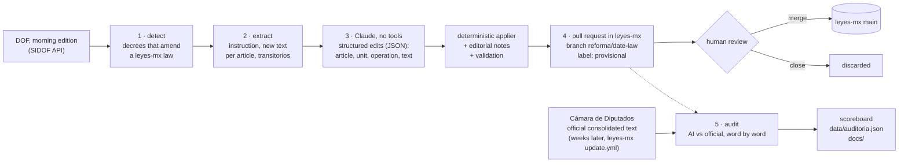

<p align="center">
  
</p>

<p align="center">
  <b>English</b> · <a href="README.es.md">Español</a> · <a href="https://beg-lag.github.io/reforma-al-dia/">Scoreboard</a>
</p>

<p align="center">
  <a href="https://github.com/BEG-lag/reforma-al-dia/actions/workflows/ci.yml"></a>
  <a href="LICENSE"></a>
  
  
  
</p>

# reforma-al-dia

**The morning a reform is published, the law is already updated, as a pull request.**
When Mexico's *Diario Oficial de la Federación* (DOF) publishes a decree that amends one of the
federal laws kept in [leyes-mx](https://github.com/BEG-lag/leyes-mx), an AI agent applies the
amendments to the law's Markdown text the same morning and opens a pull request for a human to
review and merge. Weeks later, when the Cámara de Diputados publishes its official consolidated
text, the system audits itself: it compares, word by word, what the AI applied with the official
text, and keeps a public accuracy scoreboard.

> [!IMPORTANT]
> **Provisional AI-applied text. Only the DOF is authoritative. Not legal advice.**

## The numbers (backtest on real reforms)

Before trusting it with tomorrow's DOF, the whole pipeline was replayed on **34 real decrees**
published between April 2019 and October 2026, across **16 laws** (the Constitution, the
Amparo law, the Water law, the competition law, the civil, commercial, tax and criminal codes,
and others). For each one, leyes-mx has the law the morning before the decree and the official
consolidation after it, with that single decree in between. The pipeline started from the
earlier version and the DOF text, exactly as it would have on the day, and its result was
compared with the official text.

| Result, per article the AI applied | Articles | Share |
|---|---:|---:|
| **Exact**: identical to the official text, byte for byte | **582** | **90.7%** |
| **Normalized**: identical after normalizing whitespace, punctuation and quotes | 33 | 5.1% |
| **Mismatch**: different words, every one published with a word diff | 27 | 4.2% |
| *Total applied* | *642* | |
| Not applied: the decree changed it, the AI sent it to human review instead of guessing | 1 | |
| Changed by the Cámara outside the decree (excluded) | 22 | |

What the 27 mismatches are, classified deterministically and then read one by one:

- **20** differ only in repeal placeholders: the decree prints "Se deroga." for a repealed
  paragraph and the AI copies it; the Cámara sometimes drops those lines from the
  consolidated text (and sometimes keeps them, e.g. "XV. Se deroga" in the same law).
- **1** differs only because the official text adds a Cámara annotation (updated amounts).
- **6** differ in the text itself. Reading them: 3 are in the competition law, whose official
  version is dated four months after the decree and already includes a later decree
  (the homologation to the new Código Nacional de Procedimientos Civiles y Familiares);
  1 is a paragraph of the next decree article glued into the official text by the source file;
  1 keeps an SCJN annotation that the Cámara dropped; and **1 is a real AI error**: in article
  25 of the competition law the model counted the "..." placeholders differently and kept a
  paragraph that the decree replaced.

Other measurements: editorial notes ("Fracción reformada DOF ...") match exactly in 556 of 642
articles; the decree's transitorios block matches in 27 of 35 cases (8 exact, 19 normalized);
and in **12 of 35** cases the whole body of the law is identical to the official one.
Restricted to 2025 and 2026 (14 decrees): 497 exact, 33 normalized and 22 mismatches of 552
applied articles (90.0% exact).

Every case is inspectable article by article (text before, AI text, official text and word diff)
on the [scoreboard](https://beg-lag.github.io/reforma-al-dia/), and the data is in
[`data/auditoria.json`](data/auditoria.json) and [`data/casos/`](data/casos/). The selection rule
and the skipped pairs, with the reason for each, are in [`data/backtest.json`](data/backtest.json).

It took **94 calls** to Claude (Opus 5.5 through the owner's Claude Code CLI), about 40 minutes
of model time in total, 25 seconds per call on average. Every response is cached in
[`data/cache/claude/`](data/cache/claude/), so `reforma-al-dia backtest run --offline`
reproduces every number above without calling the model.

## How it works



1. **Detect.** For a date, the table of contents of the DOF (the public SIDOF API, the same one
   [mcp-dof](https://github.com/BEG-lag/mcp-dof) documents) is filtered for decrees that
   *reforma*, *adiciona* or *deroga* and name a law in the leyes-mx catalog, or that have a
   generic title ("diversos ordenamientos"). The full text decides: only decrees of the Congress
   count, and each operative article ("Artículo Segundo.- Se reforman ... de la Ley X") is matched
   to its law. One decree can amend several laws.
2. **Extract.** The decree HTML becomes paragraphs; each law's part is split into the operative
   instruction, one block of new text per article (with the "..." placeholders that stand for
   unchanged text), division headings, and the transitorios. The instruction is also parsed
   deterministically into (operation, article, unit) to know which articles must change.
3. **Apply with Claude.** The model receives the instruction, the decree text of each affected
   article and the current text of that article as numbered blocks, and returns **structured
   edits**: for each unit (párrafo, fracción, inciso...) the operation (reform, add, repeal), the
   blocks it replaces or follows, and the exact new text. Never a rewritten file. It runs as
   `claude -p --output-format json --json-schema ... --tools "" --strict-mcp-config --safe-mode
   --setting-sources "" --disable-slash-commands --no-session-persistence` from an empty folder,
   so it can only return text, and no personal configuration (CLAUDE.md, hooks, MCP servers,
   skills) can trigger anything. Anything ambiguous goes to a `needs_review` list instead of being
   guessed. Then deterministic code does the rest: it applies the edits, writes the Cámara-style
   editorial notes ("Párrafo reformado DOF 15-12-2025", appending dates to existing notes), inserts
   new articles in numeric order and new headings before them, appends the decree's transitorios,
   updates the front matter, and **validates**: no article outside the plan changed, the article
   count only grew by the articles added, no heading disappeared, numbering is still valid as
   `leyes validate` checks it, every article the decree names was edited or flagged, and every
   edit lines up with the block it replaces ("fracción III" must replace a block that starts with
   "III.").
4. **Propose.** A branch `reforma/YYYY-MM-DD-<law>` in a leyes-mx clone, one commit per decree by
   the leyes-mx bot `Diario Oficial (leyes-mx) <dof@leyes-mx.invalid>` dated on the DOF date, with
   the trailers `Applied-by: Claude (provisional until the official consolidated text)`,
   `DOF: <url>` and `DOF-Nota: <code>`. The pull request text has the decree and its link, the
   instruction, a table of every edit, the items that need human review as a checklist, the
   validations and the diff stats, under a "provisional" warning and label.
5. **Audit.** When the official consolidated text reaches leyes-mx (its daily `update.yml`), each
   proposal is re-run from the cache and compared, article by article, with the official text:
   exact, normalized, or mismatch with a word-level diff. Results go to `data/casos/` and
   `data/auditoria.json`, and the site in `docs/` is regenerated.

## Human in the loop

Nothing merges by itself. The AI proposes, a person decides. The PR says, in its first line, that
the text is provisional and that only the DOF is authoritative; it lists what the model was unsure
about; and it is replaced by the official consolidation when that arrives, whatever the reviewer
did. The audit is public precisely so that the trust a reviewer gives these PRs is earned with
evidence, not assumed.

## What a pull request looks like

A real one from the backtest (`uv run reforma-al-dia backtest pr 2025-01-02-lgra`, abridged): the
LGRA reform of January 2, 2025. All 13 articles it touched later matched the official text
exactly.

```markdown
> [!WARNING]
> **Texto provisional aplicado por IA. Sólo el DOF es fuente oficial. No es asesoría legal.**

**Decreto:** [DECRETO por el que se reforman, adicionan y derogan diversas disposiciones de la
Ley General de Responsabilidades Administrativas.](https://dof.gob.mx/nota_detalle.php?codigo=5746626&fecha=02/01/2025)
**Publicado en el DOF:** 02-01-2025 · nota 5746626
**Ley:** Ley General de Responsabilidades Administrativas (`leyes/lgra.md`)

### Cambios aplicados

| Artículo | Unidad | Operación |
|---|---|---|
| Artículo 3. | fracción XXI Bis | adición |
| Artículo 3. | fracción XXV | derogación |
| Artículo 6. | artículo completo | reforma |
| Artículo 7. | párrafo primero | reforma |
| Artículo 9. | fracción V | reforma |
| ... | ... | ... |
| Artículo 49. | fracción VI | reforma |
| Artículo 148. | artículo completo | reforma |

### Requiere revisión humana (0)

Ninguno: todas las unidades que nombra el decreto se aplicaron y pasaron las validaciones.

### Validaciones automáticas

- Artículos modificados: 13 (Artículo 3., Artículo 6., Artículo 7., ...).
- Ningún otro artículo cambió; ningún encabezado desapareció; la numeración sigue siendo válida.
- Artículos en la ley: 234 → 234 (0 adicionados).
- Diff: +84 −26 líneas en `leyes/lgra.md`.
```

The commit it would push:

```text
LGRA: reforma DOF 02-01-2025 (provisional)

Texto aplicado por IA a partir del decreto publicado en el Diario Oficial de la
Federación. Es provisional hasta que la Cámara de Diputados publique el texto
consolidado oficial; sólo el DOF es fuente oficial.

- DECRETO por el que se reforman, adicionan y derogan diversas disposiciones de la Ley General de Responsabilidades Administrativas. (DOF 02-01-2025)
  https://dof.gob.mx/nota_detalle.php?codigo=5746626&fecha=02/01/2025

Applied-by: Claude (provisional until the official consolidated text)
DOF: https://dof.gob.mx/nota_detalle.php?codigo=5746626&fecha=02/01/2025
DOF-Nota: 5746626
Reforma-al-dia: 0.1.0
```

And a live dry run, on the DOF of November 13, 2026 (two decrees, three laws), which flags that the
leyes-mx copy of the income tax law is behind the Cámara's index:

```console
$ uv run reforma-al-dia run --date 2026-11-13
reforma-al-dia 2026-11-13 (dry run)
  LISR DOF 13-11-2026 nota 5803758: DRY RUN, committed 3de5d3650 on local branch reforma/2026-11-13-lisr (+345 -253)
  CPF DOF 13-11-2026 nota 5803837: DRY RUN, committed c472fcce6 on local branch reforma/2026-11-13-cpf (+144 -52)
  LFPPI DOF 13-11-2026 nota 5803837: DRY RUN, committed a47d745f1 on local branch reforma/2026-11-13-lfppi (+104 -16)
```

## Run it

Python 3.12+, [uv](https://docs.astral.sh/uv/), and the [Claude Code](https://claude.com/claude-code)
CLI logged in. Live runs also need the GitHub CLI with push access to leyes-mx.

```bash
git clone https://github.com/BEG-lag/reforma-al-dia && cd reforma-al-dia
uv sync

uv run reforma-al-dia detect --date 2026-11-13         # which decrees amend which laws
uv run reforma-al-dia run --date today                 # dry run: local branch + PR text, nothing pushed
uv run reforma-al-dia run --date today --no-dry-run    # push the branch and open the PR
uv run reforma-al-dia audit                            # audit proposals whose official text arrived

uv run reforma-al-dia backtest screen --since 2019-01-01   # pick clean single-decree pairs
uv run reforma-al-dia backtest run --offline               # replay them from the cached responses
uv run reforma-al-dia backtest pr 2025-01-02-lgra          # the PR a past case would have opened
uv run reforma-al-dia site                                 # rebuild docs/ (the scoreboard)
uv run pytest
```

The leyes-mx clone lives in `~/.cache/reforma-al-dia/leyes-mx` (or `--leyes`, `$REFORMA_LEYES`).
Other settings: `REFORMA_MODEL`, `REFORMA_EFFORT`, `REFORMA_WORKERS` (parallel model calls, 4 by
default) and `REFORMA_CLAUDE` (path to the CLI).

**Daily schedule.** About 08:45 Mexico City time, after the morning edition. A launchd agent and a
wrapper script are in [`scheduling/`](scheduling/), with instructions; nothing is installed for you.

**Idempotency and logs.** A decree and a law are proposed at most once: the run checks the public
record in `data/propuestas/`, a remote branch that already carries the decree (`DOF-Nota:` trailer)
and an existing pull request, in that order. Dry runs keep their records in `.work/` and never
block a real run. Everything is logged to `.work/reforma-al-dia.log`.

## Data

- [`data/auditoria.json`](data/auditoria.json): the scoreboard. Totals per source (backtest, live,
  all) and every case with each article's status, cause and word diff. The schema is documented
  in [`src/reforma_al_dia/scoreboard.py`](src/reforma_al_dia/scoreboard.py); CI checks that the
  file is exactly what the recorded cases produce.
- [`data/casos/<id>.json`](data/casos/): one file per case with the decree, the instruction, the
  decree text per article, the model's edits, the review items, the model calls and the full text
  of every article before, as applied by the AI, and official.
- [`data/backtest.json`](data/backtest.json): the pairs selected for the backtest and the ones
  skipped, with the reason.
- [`data/cache/claude/`](data/cache/claude/): every model response, keyed by a hash of the
  request.

## Limitations and failure modes

- **Placeholders are the hard part.** Decrees show unchanged text as "...", and how many "..."
  stand for which paragraphs is the main source of real errors (the one genuine mismatch of the
  backtest is exactly this). Paragraph counting in Mexican drafting (are fracciones párrafos?)
  is not always consistent between decrees.
- **The Cámara is not a mechanical consolidator.** It drops "Se deroga" paragraphs in some laws
  and keeps them in others, fixes typos, adds annotations (SCJN invalidity, updated amounts) and
  sometimes publishes a consolidation that already includes a later decree. All of that shows up
  as mismatches; the scoreboard classifies the harmless patterns but does not hide them.
- **Not handled**: decrees that only amend transitorios of earlier decrees, SCJN declarations of
  invalidity, laws issued from scratch (they enter leyes-mx through its catalog), and regulations.
  Five pairs were skipped from the backtest for these or for source noise, each with its reason
  in `data/backtest.json`.
- **A stale base text means a wrong result.** If the leyes-mx copy of a law is behind, the
  amendments are applied to an outdated text. The run checks the Cámara's index and the reform
  list and puts a warning at the top of the PR's review list.
- **Editorial notes are best effort.** They follow the Cámara's dominant style and match in 87%
  of applied articles; they are the Cámara's apparatus, not law, and are scored separately.
- **The model can be wrong with confidence.** That is why there are validations, a review list,
  a human merge, and a public audit. The provisional text is never presented as the law.

## Repository layout

```text
src/reforma_al_dia/
  sidof.py          polite SIDOF client with a disk cache
  detect.py         which decrees of a date amend which catalog laws
  decree.py         decree HTML -> sections per law -> article blocks, transitorios
  instructions.py   "Se reforman los artículos ..." -> (operation, article, unit)
  lawdoc.py         byte-exact read/write of a leyes-mx law, article index
  prompt.py         the system prompt and the per-batch request
  claude.py         headless Claude Code CLI call, tools disabled, cached
  edits.py          the edit schema
  applier.py        deterministic application, editorial notes, transitorios
  validate.py       alignment and whole-law checks
  pipeline.py       one decree + one law -> amended law + review list
  propose.py        branch, bot commit, PR title and body, gh command
  runner.py         the daily run, idempotency, live audit
  audit.py          exact / normalized / mismatch, causes, word diff
  backtest.py       replay of real past reforms
  scoreboard.py     data/auditoria.json
  site.py           docs/ (GitHub Pages)
scheduling/         launchd agent, wrapper script, instructions
tests/              pytest, with recorded DOF responses and recorded Claude edits
```

## Author

**Benjamín Esponda García**, Mexican corporate lawyer who builds with AI.
[pivotek.mx](https://pivotek.mx) · [github.com/BEG-lag](https://github.com/BEG-lag)

Related: [leyes-mx](https://github.com/BEG-lag/leyes-mx) (Mexican federal law as code, every reform
a commit) and [mcp-dof](https://github.com/BEG-lag/mcp-dof) (an MCP server for the DOF).

## License

Code: [MIT](LICENSE). Law and decree texts are public domain in Mexico (Ley Federal del Derecho de
Autor, art. 14, fr. VIII). Fonts in `docs/assets/fonts/` are under the SIL Open Font License.

**Provisional AI-applied text. Only the DOF is authoritative. Not legal advice.**
